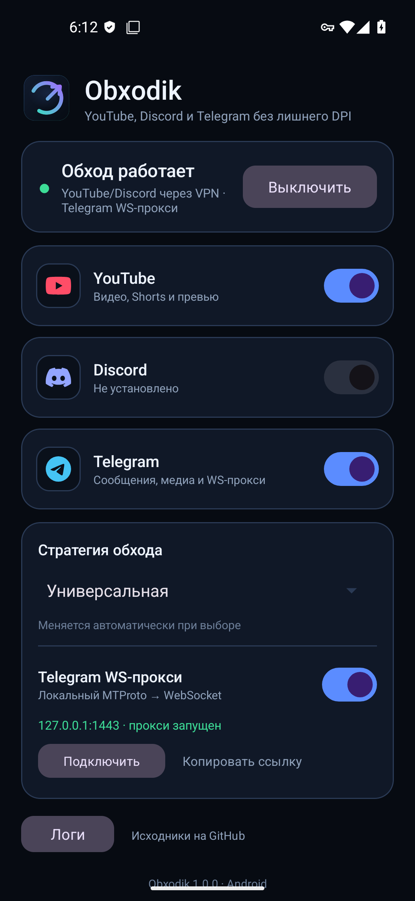

# Obxodik Android

**Windows-версия:** [Obxodik-Windows](https://github.com/tokhirdzhon/Obxodik-Windows)  
**Скачать APK:** [Obxodik-Android-1.0.0.apk](https://github.com/tokhirdzhon/Obxodik-Android/releases/latest)

Мобильная версия Obxodik для **YouTube**, **Discord** и **Telegram** на Android 10+.
Работает **без root** через системный `VpnService`, не отправляет трафик на сторонние
VPN-серверы и не скрывает IP-адрес.

<p align="center">
  
</p>

## Возможности

- Отдельные переключатели **YouTube**, **Discord**, **Telegram**.
- Раздельное туннелирование: VPN обрабатывает только выбранные приложения.
- Локальный движок **ByeDPI** — фрагментация TLS/HTTP и обход DPI.
- **Telegram WS-прокси** — локальный MTProto → WebSocket мост, помогает при блокировке по IP.
- Несколько стратегий ByeDPI, журнал, автозапуск после перезагрузки.
- Работает без root, без аккаунта и без внешнего VPN-сервера.

## Как это работает

```
YouTube / Discord ──► VpnService (только выбранные приложения)
                            │
                            ▼
                     hev-socks5-tunnel
                            │
                            ▼
                  ByeDPI (127.0.0.1:1080)
                            │
                            ▼
                    интернет без DPI

Telegram ──► 127.0.0.1:1443 (MTProto)
                │
                ▼
        tg-ws-proxy (Python/Chaquopy)
                │
                ▼
        WebSocket/TLS → Telegram
```

- VPN поднимается только если включён YouTube, Discord или Telegram без WS-прокси.
- Если для Telegram включён WS-прокси, VPN для него не нужен — Telegram подключается
  к локальному `127.0.0.1`.
- Собственный трафик приложения исключается из VPN автоматически, чтобы не было петли.

## Установка

1. Скачайте APK из [релизов](https://github.com/tokhirdzhon/Obxodik-Android/releases/latest).
2. Разрешите установку из неизвестных источников.
3. При первом включении разрешите VPN.
4. Для Telegram включите **«Telegram WS-прокси»** и нажмите **«Подключить»**, затем
   подтвердите прокси в Telegram.

Требования: **Android 10+**, `arm64-v8a` (обычные телефоны) или `x86_64` (эмулятор).

## Ограничения

- Одновременно в Android может быть активен только один VPN.
- Расход батареи выше, чем без VPN.
- YouTube использует QUIC; при проблемах помогает смена стратегии.
- Звонки Telegram через MTProto-прокси не работают — для звонков нужен полноценный VPN.
- Эффективность DPI-обхода зависит от оператора и региона.

## Сборка

Требования: JDK 17, Android SDK 35, Python 3.12, интернет для Chaquopy/pip.

```powershell
$env:JAVA_HOME = "C:\path\to\jdk-17"
$env:ANDROID_HOME = "C:\path\to\android-sdk"
$env:OBXODIK_BUILD_PYTHON = "C:\path\to\python3.12\python.exe"

.\gradlew assembleDebug
# APK: app\build\outputs\apk\debug\app-debug.apk
```

Release-сборка с собственной подписью:

```powershell
$env:OBXODIK_KEYSTORE = "C:\path\to\release.jks"
$env:OBXODIK_STORE_PASSWORD = "..."
$env:OBXODIK_KEY_ALIAS = "obxodik"
$env:OBXODIK_KEY_PASSWORD = "..."
.\gradlew assembleRelease
```

## Структура

```
app/src/main/java/ru/obxodik/android/
  MainActivity.java          интерфейс
  Prefs.java                 настройки и секрет прокси
  AppPackages.java           пакеты YouTube/Discord/Telegram
  Strategies.java            пресеты ByeDPI
  service/ObxodikVpnService  VpnService + ByeDPI + hev
  service/TgWsService        локальный MTProto/WebSocket прокси
app/src/main/python/         Flowseal tg-ws-proxy + entrypoint
app/src/main/jniLibs/        prebuilt libbyedpi.so
app/libs/                    hev-socks5-tunnel.aar
```

## Лицензия

Android-приложение распространяется по **GPL-3.0**, потому что использует
prebuilt `libbyedpi.so` из GPL-проекта ByeDPIAndroid. Компоненты ByeDPI,
hev-socks5-tunnel и tg-ws-proxy распространяются по MIT.

Подробности и ссылки на исходники: [NOTICE.md](NOTICE.md), [LICENSE](LICENSE).

Windows-версия — отдельный репозиторий [Obxodik-Windows](https://github.com/tokhirdzhon/Obxodik-Windows)
под MIT.
